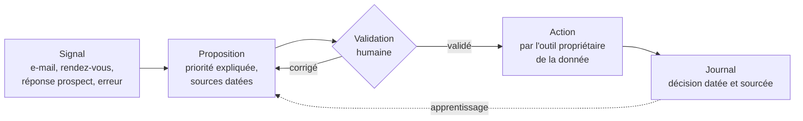
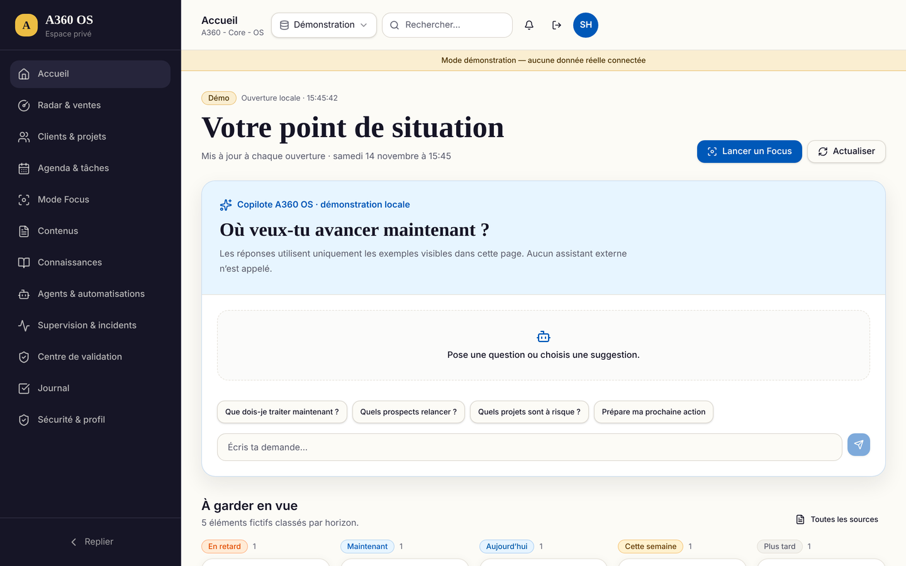
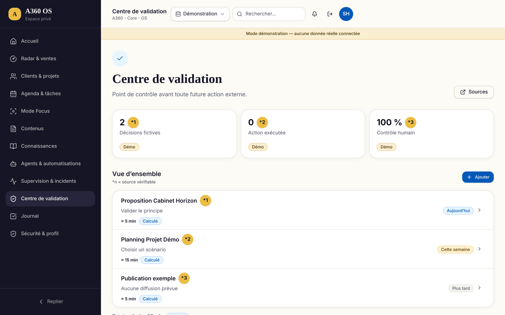
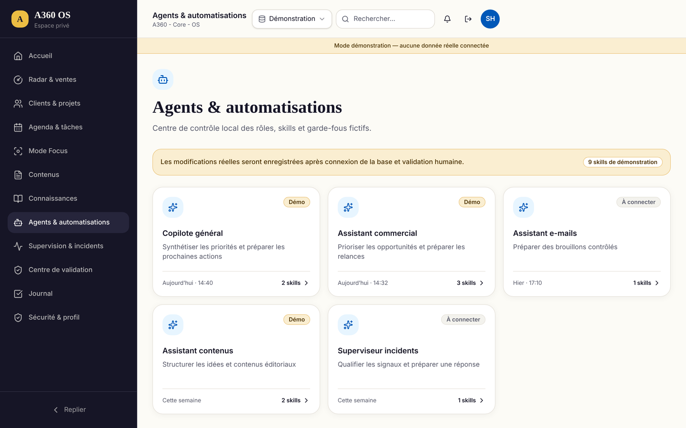

# A360 OS — le cockpit d'une agence, piloté par des agents IA sous contrôle humain

> Vitrine publique. Ce dépôt présente l'architecture et les principes d'A360 OS, l'outil que j'utilise chaque jour pour piloter mon agence. Le code de production reste privé. Aucune donnée réelle, aucun identifiant, aucune URL interne ici.

A360 OS réunit au même endroit informations, connaissances, priorités, tâches, outils et actions, sur ordinateur et sur mobile. L'essentiel du travail se fait la nuit : prospection, audits, préparation des messages. Le matin, je relis et je décide.

## Ce que fait l'outil

- Briefs vocaux du matin et du soir pour préparer la journée.
- Veilles IA, marchés et sectorielles.
- Radar 360, le moteur de prospection : environ 100 prospects visés par semaine, chacun vérifié, audité et contacté avec l'offre adaptée du catalogue ; relances à J+3, J+6 et J+10 arrêtées dès la première réponse.
- Équipes d'assistants pour chaque facette de l'agence : rédaction d'e-mails, audits, cadrage de projet relié au catalogue d'offres, posts et visuels.
- Centre de validation, journal des décisions, mode Focus, application installable sur mobile.
- Recherche dans mes propres sources (RAG), avec en option la recherche en ligne citée.

## Le principe : une information devient une action, jamais sans moi

1. **Signal** : tout ce qui arrive (e-mail, rendez-vous, réponse de prospect, erreur technique) entre dans un registre commun. Rien ne disparaît en silence : chaque signal a un état (nouveau, trié, planifié, en attente, fait, ignoré, en échec).
2. **Proposition** : l'agent concerné explique pourquoi c'est prioritaire, avec ses sources et leur date, et prépare l'action.
3. **Validation** : je relis, je corrige ou je valide.
4. **Action** : c'est l'outil propriétaire de la donnée qui exécute. Radar envoie les e-mails de prospection, l'agenda planifie, Notion range les projets.
5. **Journal** : chaque décision est datée et sourcée ; mes corrections servent à apprendre.

## En images

Écrans en mode démonstration : toutes les données sont fictives (« Cabinet Horizon », « Projet Démo »).

| Accueil | Centre de validation | Agents et automatisations |
|---|---|---|
|  |  |  |

## Une source de vérité par type de donnée

A360 OS orchestre, il ne recopie pas. Chaque information a un seul propriétaire :

| Information | Source de vérité |
|---|---|
| Prospects, pipeline, preuves de qualification | Radar 360 |
| Projets | Notion |
| Documents | Google Drive |
| E-mails et rendez-vous | Gmail, Google Agenda |
| Code | GitHub |
| Données applicatives | Supabase |
| Erreurs et usage | Sentry, PostHog |

## Garde-fous

- Lire automatiquement : oui. Préparer une action : oui. Exécuter après validation : oui. **Exécuter seul : non.**
- **Pas de preuve, pas d'envoi** : aucun message vers un contact non vérifié, aucune affirmation sans source.
- Faits et hypothèses toujours séparés, avec un niveau de fiabilité affiché (confirmé, calculé, déduit, non vérifié).
- Plafond de coût IA mensuel avec arrêt automatique ; le modèle le plus léger qui suffit pour chaque tâche.
- Accès privé avec double authentification, aucune suppression automatique, journal de chaque action.
- Sources de prospection autorisées uniquement : bases de données professionnelles, API officielles, pages web publiques.

## Stack

| Famille | Outils |
|---|---|
| Construire | Claude Code, Lovable, GitHub, Supabase (PostgreSQL et recherche vectorielle), Gemini (voix, recherche sourcée, embeddings) |
| Connecter | Notion, Google Drive, Gmail et Agenda, Canva, Ubersuggest, Apollo, Google Maps |
| Mesurer | Sentry, PostHog, page « Usages et améliorations », compteur de coût IA |

## En chiffres

- 20 audits d'entreprises préparés chaque nuit.
- Coût IA : 8 à 12 € par mois, plafonné.
- Plus de 15 h gagnées par semaine (estimation basse). Avant : jusqu'à 1 h pour un e-mail, 2 h pour se renseigner sur une entreprise.

## À propos

Conçu et construit par **Sabrina Heydel**, Product Builder IA et opérations. Ma méthode : cadrer en 8 étapes avant de construire (besoin, utilisateurs, données, taille, valeur et coût, indicateurs, garde-fous, passation), tester petit, mesurer, puis déployer ou abandonner.

Contact : sabrinaheydel@gmail.com
